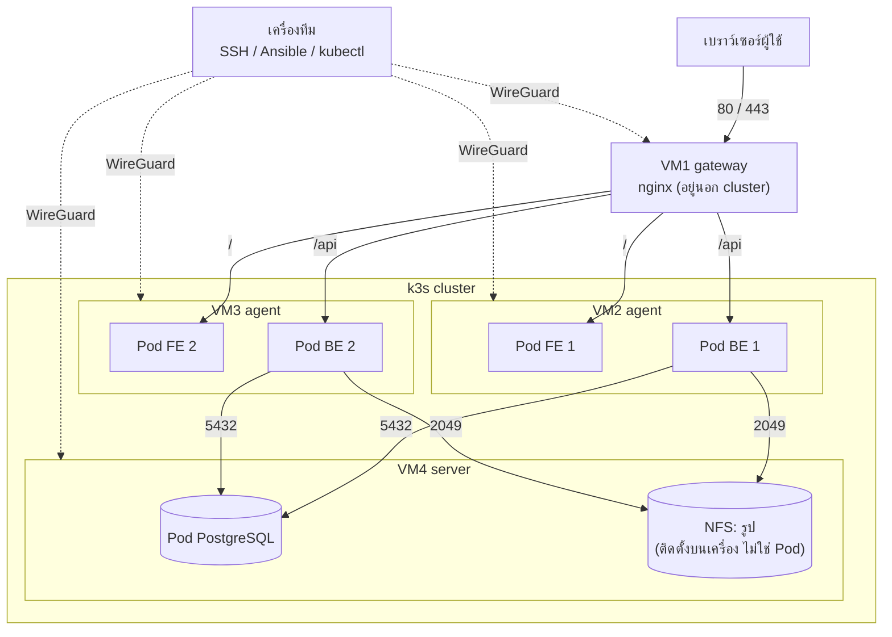

# การออกแบบ Infrastructure — equiploan

สถานะ: **ร่างเพื่อให้ทีมและอาจารย์ตรวจ** ยังไม่ได้สร้าง VM, Dockerfile, manifest หรือ playbook
และยังไม่ได้ทดสอบแบบนี้จริง ค่า RAM/CPU/ดิสก์เป็นค่าประมาณ

หลักการ: ใช้แต่ละเครื่องมือในระดับพื้นฐาน และทุกคนในทีมต้องอธิบายเหตุผลได้

## 1. ภาพรวม

การเชื่อมต่อระหว่าง VM ทุกเส้นวิ่งผ่าน WireGuard

| VM | หน้าที่ | IP ใน WireGuard | CPU | RAM | ดิสก์ |
|---|---|---|---|---|---|
| VM1 | nginx: reverse proxy + load balancer | 10.10.0.1 | 1 | 1 GB | 15 GB |
| VM2 | k3s agent: FE + BE | 10.10.0.2 | 2 | 2 GB | 20 GB |
| VM3 | k3s agent: FE + BE | 10.10.0.3 | 2 | 2 GB | 20 GB |
| VM4 | k3s server, PostgreSQL, NFS | 10.10.0.4 | 2 | 4 GB | 30 GB |
| เครื่องทีม | ผู้ดูแล คนละ 1 key | 10.10.0.11–14 | - | - | - |

รวม RAM ประมาณ 9 GB จากเครื่องที่มี 32 GB

## 2. หน้าที่ของแต่ละเครื่องมือ

| เครื่องมือ | ทำ | ไม่ทำ (เกินขอบเขต) |
|---|---|---|
| Docker | image แยก FE และ BE | - |
| k3s | FE 2, BE 2, PostgreSQL 1, ConfigMap, Secret, PVC, probes | Helm, autoscaling, service mesh |
| nginx | ประตูเข้าเดียว, แยก `/` กับ `/api`, round robin | nginx สำรอง |
| WireGuard | เครือข่ายส่วนตัวของ VM และทีม | หมุน key อัตโนมัติ |
| NFS | โฟลเดอร์รูปที่ BE ทั้งสองใช้ร่วมกัน | ที่เก็บสำรองอัตโนมัติ |
| Ansible | ตั้งค่า VM ทุกเครื่องจากไฟล์ | CI/CD |

Ansible เตรียม**เครื่อง** ส่วน Kubernetes ดูแล**แอป**บนเครื่อง

## 3. เส้นทางของคำขอ

1. **เปิดหน้าเว็บ:** เบราว์เซอร์ → nginx → FE ตัวใดตัวหนึ่ง
2. **ขอข้อมูล:** เบราว์เซอร์ → nginx (`/api`) → BE ตัวใดตัวหนึ่ง → PostgreSQL
3. **เปิดรูป:** เบราว์เซอร์ → nginx (`/api`) → BE (ตรวจสิทธิ์) → NFS

FE และ BE บน VM เดียวกันไม่ได้จับคู่กัน ผู้ใช้อาจได้หน้าจาก VM2 และข้อมูลจาก VM3

บน Windows ใช้ rewrites ของ Next.js ส่ง `/api` ไป BE เหมือนเดิม ส่วนบนระบบจริง nginx ส่ง `/api` ไป BE โดยตรง
โค้ดหน้าเว็บจึงไม่ต้องแก้ เพราะเรียก `/api/...` ที่โดเมนเดียวกันทั้งสองแบบ

## 4. Network และพอร์ต

| ปลายทาง | พอร์ต | ใครเข้าได้ |
|---|---|---|
| VM1 | 80, 443/tcp | ผู้ใช้ทุกคน |
| ทุก VM | 51820/udp (WireGuard) | VM ด้วยกันและเครื่องทีม |
| ทุก VM | 22/tcp (SSH) | ทาง WireGuard เท่านั้น |
| VM2, VM3 | 30080/tcp (NodePort FE) | VM1 ทาง WireGuard |
| VM2, VM3 | 30400/tcp (NodePort BE) | VM1 ทาง WireGuard |
| VM4 | 6443/tcp (Kubernetes API) | VM2, VM3 และทีม ทาง WireGuard |
| VM4 | 2049/tcp (NFS) | VM2, VM3 ทาง WireGuard |
| VM2–VM4 | 8472/udp (เครือข่าย Pod), 10250/tcp (kubelet) | node ด้วยกัน ทาง WireGuard |
| PostgreSQL | 5432/tcp (ClusterIP) | เรียกได้จากใน cluster เท่านั้น |

- WireGuard เชื่อม VM ทั้ง 4 ถึงกันโดยตรง (full mesh)
- k3s ใช้ IP ของ WireGuard (`--node-ip`, `--flannel-iface wg0`) และปิด Traefik กับ ServiceLB เพราะใช้ nginx แล้ว
- จำกัด NodePort ให้รับเฉพาะวง `10.10.0.0/24` ด้วย `nodeport-addresses` ของ kube-proxy
  เพราะ firewall อย่าง UFW อย่างเดียวอาจกัน NodePort ไม่ได้
- **ลำดับสำคัญ:** ต้องทดสอบ SSH ผ่าน WireGuard ให้ได้ก่อน จึงปิด SSH จากภายนอก ไม่อย่างนั้นจะเข้าเครื่องไม่ได้

## 5. Load balancer (nginx)

- ใช้ round robin ซึ่งเป็นค่าเริ่มต้น แยก upstream ของ FE และ BE
- `max_fails` / `fail_timeout` เป็นการตรวจแบบ passive: เครื่องพลาดก่อน แล้วจึงถูกข้ามชั่วคราว
- คำขอ POST ที่ส่งไปแล้วพลาด nginx จะไม่ส่งซ้ำโดยค่าเริ่มต้น ผู้ใช้อาจต้องกดใหม่ แต่กันการบันทึกซ้ำ
- ต้องตั้ง `client_max_body_size 6m` เพราะค่าเริ่มต้น 1 MB จะทำให้อัปโหลดรูปไม่ผ่าน ทั้งที่ระบบรับถึง 5 MB
- ไม่เปิด `/healthz` และ `/readyz` สู่ภายนอก

## 6. Kubernetes

| ส่วน | ชนิด | จำนวน | อยู่ที่ |
|---|---|---|---|
| FE | Deployment + Service (NodePort 30080) | 2 | VM2, VM3 คนละ 1 |
| BE | Deployment + Service (NodePort 30400) | 2 | VM2, VM3 คนละ 1 |
| PostgreSQL 17 | StatefulSet + Service (ClusterIP) | 1 | VM4 |
| สร้างตาราง | Job รัน `db:init` | ครั้งละ 1 | node ใดก็ได้ |

- ใช้ label + nodeSelector: VM2/VM3 = `role=app`, VM4 = `role=db`
- ใช้ pod anti-affinity แบบบังคับ ให้ FE (และ BE) สองตัวอยู่คนละเครื่อง
- Service ของ FE/BE ตั้ง `externalTrafficPolicy: Local` ให้แต่ละเครื่องส่งงานเข้า Pod ของตัวเอง
  ไม่อย่างนั้น Kubernetes จะกระจายซ้ำอีกชั้น ทำให้ไม่เห็น round robin ของ nginx ชัดเจน
- อัปเดตแบบ `maxSurge: 0, maxUnavailable: 1` เพราะมี 2 เครื่องและห้ามอยู่ซ้ำ จึงไม่มีที่ให้ Pod ตัวที่สาม
- ผลของการบังคับแยกเครื่อง: ถ้า VM3 ดับ Pod ทดแทนจะค้าง Pending จน VM3 กลับมา ระบบเหลืออย่างละ 1 ตัว

### Probes
| Pod | liveness | readiness |
|---|---|---|
| BE | `/healthz` (ไม่เช็ก DB) | `/readyz` (เช็ก DB) |
| FE | `/login` | `/login` |
| PostgreSQL | `pg_isready` | `pg_isready` |

liveness ไม่เช็ก DB เพราะถ้า DB ล่ม การรีสตาร์ต BE ไม่ได้ช่วยแก้

### ค่าตั้งค่า
| ConfigMap | Secret |
|---|---|
| `PORT`, `COOKIE_SECURE`, `UPLOAD_DIR`, `ADMIN_EMAIL`, `ADMIN_NAME` | `DATABASE_URL`, `JWT_SECRET`, `ADMIN_PASSWORD`, รหัส PostgreSQL |

BE ทุกตัวใช้ `JWT_SECRET` เดียวกัน ผู้ใช้จึงสลับ BE ได้โดยไม่ต้องล็อกอินใหม่และไม่ต้องใช้ sticky session
Secret ของ Kubernetes เป็นแค่ base64 ไม่ใช่การเข้ารหัส จึงห้าม commit ไฟล์ที่มีค่าจริง

## 7. ที่เก็บข้อมูล

| ข้อมูล | PVC | ที่เก็บจริง | เหตุผล |
|---|---|---|---|
| รูป | ReadWriteMany | NFS บน VM4 | BE สองตัวอยู่คนละเครื่อง ต้องเห็นรูปชุดเดียวกัน |
| PostgreSQL | ReadWriteOnce | ดิสก์ VM4 (local-path ของ k3s) | มีตัวเดียว ไม่ต้องแชร์ |

PVC คือคำขอพื้นที่ของ Pod, PV คือพื้นที่ที่จัดให้, NFS คือที่เก็บจริง

BE mount รูปที่ `/data/uploads` และตั้ง `UPLOAD_DIR=/data/uploads` สิทธิ์โฟลเดอร์บน NFS ต้องตรงกับผู้ใช้ใน container

**สำรองข้อมูล (ขั้นพื้นฐาน):** รัน `pg_dump` และคัดลอกโฟลเดอร์รูปด้วยมือไปไว้นอก VM4 ต้องสำรองทั้งคู่
เพราะ DB เก็บเพียงชื่อไฟล์รูป

## 8. Ansible

| role | เครื่อง | ทำอะไร |
|---|---|---|
| `common` | ทุกเครื่อง | แพ็กเกจพื้นฐาน, firewall |
| `wireguard` | ทุกเครื่อง | key, config, เปิด service |
| `nfs` | VM4 (server), VM2–3 (client) | แชร์โฟลเดอร์รูป |
| `k3s` | VM4 (server), VM2–3 (agent) | ติดตั้งและต่อ node, label |
| `nginx` | VM1 | ติดตั้งและวาง config |

- Ansible ใช้ Windows เป็นเครื่องสั่งงานโดยตรงไม่ได้ ให้รันจาก WSL หรือ VM Linux
- ค่าลับ (private key, k3s token) เข้ารหัสด้วย Ansible Vault และไม่ commit รหัสของ Vault

## 9. ถ้าส่วนใดล่ม

| ล่ม | ผล |
|---|---|
| Pod FE หรือ BE 1 ตัว | Kubernetes สร้างใหม่ อีกตัวรับงานแทน อาจสะดุดช่วงสั้นๆ |
| VM2 **หรือ** VM3 | ยังใช้ได้ด้วยอีกเครื่อง |
| โปรแกรม k3s server บน VM4 | Pod ที่รันอยู่ทำงานต่อ แต่สั่งงาน cluster และสร้าง Pod ทดแทนไม่ได้ |
| VM4 ทั้งเครื่อง | ใช้ข้อมูลและรูปไม่ได้ |
| VM1 | เข้าเว็บไม่ได้ |
| เครื่องจริงที่รัน VM ทั้งหมด | ระบบดับทั้งหมด |

VM1 และ VM4 เป็นจุดเดียวที่ล่มแล้วระบบหยุด (single point of failure) เป็นข้อจำกัดที่ยอมรับ
เพราะการแก้ต้องมี nginx สำรอง, DB replication และที่เก็บรูปสำรอง ซึ่งเกินระดับพื้นฐาน

## 10. สิ่งที่ต้องแก้ในโค้ดก่อน deploy

พบจากการอ่านโค้ดปัจจุบัน ยังไม่ได้แก้

| เรื่อง | ปัญหา | แนวทาง |
|---|---|---|
| `backend/src/db.js` | ไม่มีตัวรับ event `error` ของ pool ถ้า DB ตัดการเชื่อมต่อที่ว่างอยู่ BE อาจหยุดทั้งโปรเซส | เพิ่ม `pool.on('error', ...)` |
| `seedAdmin` | รันครั้งเดียวตอนเริ่ม ถ้ายังไม่มีตาราง จะไม่สร้าง admin จน BE เริ่มใหม่ | รัน Job สร้างตารางให้เสร็จก่อนเปิด BE |
| `/readyz` | เช็กแค่ `SELECT 1` จึงผ่านแม้ยังไม่มีตาราง | ใช้ลำดับ Job ข้างบนกันไว้ |
| `db-init.js` | อ่าน `../../db/schema.sql` ซึ่งอยู่นอกโฟลเดอร์ backend | image ของ BE ต้องมี `db/schema.sql` ด้วย |
| `BACKEND_URL` | ค่า rewrites ถูกบันทึกตอน build | ไม่กระทบแบบนี้ เพราะ nginx ส่ง `/api` ไป BE เอง |
| `COOKIE_SECURE` | ถ้าเป็น `true` แต่เข้าเว็บด้วย HTTP จะล็อกอินไม่ติด | HTTP ใช้ `false`, HTTPS ใช้ `true` |

## 11. ลำดับการทำ

1. สร้าง image ของ FE และ BE แล้วรันทดสอบ
2. สร้าง VM4 เครื่องเดียว ติดตั้ง k3s ด้วยมือให้แอปทำงาน
3. สร้าง VM ที่เหลือ เชื่อมด้วย WireGuard แล้วต่อ agent
4. ตั้ง NFS และเพิ่ม BE เป็น 2 ตัว
5. ตั้ง nginx บน VM1
6. ย้ายสิ่งที่ทำด้วยมือเป็น Ansible แล้วทดสอบกับ VM ใหม่
7. เปิด HTTPS (ถ้าทำ)

## 12. การสาธิต

| ทดสอบ | ผลที่คาด |
|---|---|
| ดู log ของ BE หรือ nginx ขณะส่งคำขอหลายครั้ง | คำขอสลับไปสองเครื่อง |
| อัปโหลดรูปผ่าน BE ตัวหนึ่ง แล้วเปิดผ่านอีกตัว | เห็นรูปเดียวกัน (NFS) |
| ลบ Pod ของ BE | Pod ใหม่ถูกสร้าง |
| ลบ Pod ของ PostgreSQL | สะดุดระหว่างสร้างใหม่ แต่ข้อมูลยังอยู่ (PVC) |
| ปิด VM3 | เว็บยังใช้ได้ |
| ปิด WireGuard ที่เครื่องทีมแล้ว SSH | เข้าไม่ได้ เปิดแล้วเข้าได้ |
| รัน playbook ซ้ำ | `changed=0` |

## 13. คำถามที่อาจารย์อาจถาม

- **BE กับ DB แยกกันไหม?** แยก เป็นคนละ Pod และคนละ VM คุยกันผ่าน network
- **ทำไม nginx อยู่นอก cluster?** เป็นประตูเดียวจากภายนอก เครื่องที่เปิดสู่ภายนอกจึงมีโปรแกรมน้อยที่สุด
- **มี Service แล้วทำไมต้องมี nginx?** Service ให้ชื่อคงที่และกระจายงานใน cluster ส่วน nginx รับจากภายนอก แยกพาธ และข้ามเครื่องที่ล่ม
- **ทำไม DB มีตัวเดียว?** หลายตัวต้องทำ replication ไม่ใช่แค่เพิ่มจำนวน เพราะข้อมูลต้องตรงกัน
- **admin สองคนอนุมัติพร้อมกันคนละ BE ได้ไหม?** ไม่ได้ unique index ใน DB ยอมให้มี approved รายการเดียวต่ออุปกรณ์
- **ทำไมไม่เก็บรูปใน DB?** DB เก็บเฉพาะชื่อไฟล์ จึงเล็กและสำรองง่าย
- **WireGuard จำเป็นไหมถ้า VM อยู่เครื่องเดียวกัน?** ประโยชน์จริงเห็นชัดเมื่อเครื่องอยู่คนละที่ ในงานนี้ใช้แยกช่องทางดูแลระบบออกจากช่องทางผู้ใช้

## 14. สิ่งที่ต้องตัดสินใจ

- [ ] โปรแกรมสร้าง VM (VirtualBox, VMware, Hyper-V) และ OS (เสนอ Ubuntu Server LTS)
- [ ] รูปแบบ network ของ VM: ถ้าเพื่อนต้องเข้าจากเครื่องอื่น ต้องเข้าถึงพอร์ต WireGuard ของ VM ได้ (เช่น bridged)
- [ ] ทดสอบว่า WSL เข้าถึงเครือข่าย WireGuard ได้ หรือใช้ VM Linux รัน Ansible
- [ ] ที่เก็บ image: Docker Hub, GHCR หรือ import เข้า node เอง
- [ ] HTTP หรือ HTTPS แบบ self-signed
- [ ] วันที่อาจารย์ให้เริ่มส่วน deploy
- [ ] เพิ่ม nginx, WireGuard, Ansible, NFS ลงใน `CLAUDE.md` เมื่ออาจารย์เห็นชอบ
